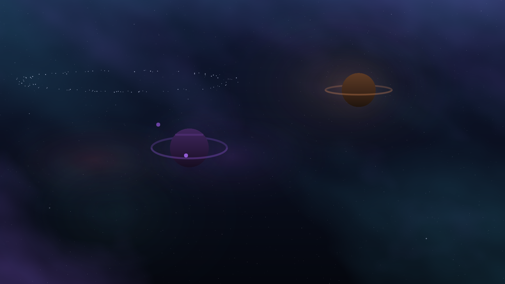

# Kumonari

A deep space theme for [Omarchy](https://omarchy.org): four generated
wallpapers, a cold palette, and Tokyo Night in the editors.



The worlds, gas and comet in the preview are not part of the theme. They come
from [kumonari.sky](https://github.com/sterre-g/omarchy-kumonari-sky), an
optional shell plugin that draws a sky over the wallpaper, rolled fresh every
morning, for as long as this theme is worn. The theme on its own is the still
pictures and the colours.

## Install

```sh
omarchy theme install https://github.com/sterre-g/omarchy-kumonari-theme
```

That is the whole theme: colours, wallpapers, icons, terminal and editors.
Installed from git, Omarchy builds the terminal and editor colours from
`colors.toml`; `neovim.lua` and `vscode.json` here only apply to a copy you put
in `~/.config/omarchy/themes` yourself.

For the sky:

```sh
omarchy plugin add https://github.com/sterre-g/omarchy-kumonari-sky.git --enable
omarchy restart shell
```

The sky used to live in this repository and came in with `./install.sh`. If you
installed it that way, take it out with `omarchy plugin remove kumonari.sky`
first: `omarchy plugin add` refuses an id that is already installed.

## Removing it

```sh
omarchy plugin remove kumonari.sky   # the sky, if you added it
omarchy theme remove kumonari
```

## Layout

```
colors.toml          the palette, and the only file the theme strictly needs
backgrounds/         the still pictures
bin/backgrounds.sh   which is where they come from
icons.theme          the icon set
neovim.lua           Tokyo Night for Neovim, local copies only
vscode.json          Tokyo Night for VS Code, local copies only
```

`bin/backgrounds.sh` rebuilds `backgrounds/` from nothing but ImageMagick, node
and a seed. Its stars are scattered the way the sky plugin scatters them, so a
seed keeps giving the same picture.

## Credit

The wallpapers are generated by `bin/backgrounds.sh` and are not photographs of
anything. The sky's theme scoping came out of fixing the same problem in
[codincod-theme](https://github.com/reeveng/codincod-theme), which is where the
idea of a wallpaper that is actually running came from.

MIT.
